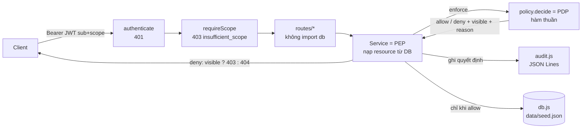

# REPORT — Block 6: Authorization & Access Control cho Task Management API

Nhóm 07 · 23127045 · 23127102 · 23127159 · 23127183 · 23127393

Báo cáo này giải thích **các lựa chọn của nhóm dẫn tới kết quả cuối cùng**: chọn gì, không chọn gì, vì sao, và chấp nhận đánh đổi nào. Mọi con số đều lấy từ lượt chạy thật, lưu trong [docs/evidence/](docs/evidence/) và tổng hợp ở [EVIDENCE.md](EVIDENCE.md). Bản trình chiếu là [REPORT.html](REPORT.html), mở offline được, có chế độ đọc tài liệu kèm giải thích từng slide. Đối chiếu từng yêu cầu của đề với nơi hiện thực nằm ở [AUDIT.md](AUDIT.md).

## Mục lục

1. [Kết quả cuối cùng](#1-kết-quả-cuối-cùng)
2. [Bài toán và phạm vi](#2-bài-toán-và-phạm-vi)
3. [Kiến trúc tổng thể](#3-kiến-trúc-tổng-thể)
4. [Các lựa chọn và lý do](#4-các-lựa-chọn-và-lý-do)
5. [Bảng tóm tắt lựa chọn](#5-bảng-tóm-tắt-lựa-chọn)
6. [Chính sách quyền](#6-chính-sách-quyền)
7. [Quá trình V1 → V4](#7-quá-trình-v1--v4)
8. [Kiểm thử và evidence](#8-kiểm-thử-và-evidence)
9. [Phân tích bảo mật](#9-phân-tích-bảo-mật)
10. [Giới hạn và hướng phát triển](#10-giới-hạn-và-hướng-phát-triển)
11. [Trả lời câu hỏi kết thúc](#11-trả-lời-câu-hỏi-kết-thúc)
12. [Kết luận](#12-kết-luận)
13. [Phụ lục](#phụ-lục-a-thư-viện-và-phiên-bản)

## 1. Kết quả cuối cùng

| Đại lượng | Starter (chỉ kiểm token) | Bản nộp | Minh chứng |
| --- | --- | --- | --- |
| Test oracle của đề (17 tình huống) | 6/17 | **17/17** | [oracle-matrix.md](docs/evidence/oracle-matrix.md) |
| Alice (Owner Alpha) đọc B1 của project Beta | `200`, lộ toàn bộ nội dung | **`404`**, body giống hệt task không tồn tại | [curl trước](docs/evidence/v1-idor-curl-before.txt) / [sau](docs/evidence/v1-idor-curl-after.txt) |
| Bob (Member) gọi thẳng `DELETE /projects/alpha` | `204`, project bị xóa thật | **`403`**, project còn nguyên | O6, [v2-after](docs/evidence/v2-after.txt) |
| Bob tự gửi `role=Admin` (body, header, query) | lọt | **`403`** | O10 |
| Member sửa task không được giao / đã đóng | `200` | **`403`**, dữ liệu không đổi | O12, O13, [v3-after](docs/evidence/v3-after.txt) |
| Admin tenant Alpha đọc/xóa dữ liệu tenant Beta (`v4-pre`) | `200` / `204` | **`404`**, kể cả khi gửi `X-Tenant-Id: beta` | O16, O17, E23, [v4-before](docs/evidence/v4-before.txt) |
| Gỡ thành viên → mất quyền sau | — | **0 giây** (không cache, không có role trong JWT) | E5, C3 |
| Danh sách (`GET /tasks`) khớp với từng lần kiểm (`GET /tasks/:id`) | — | **6 user × 4 task khớp hoàn toàn** | C1 |
| Bản sửa sai "từ chối hết" | — | Bộ test của nhóm bắt được: **51/70 test trượt** | [deny-all.txt](docs/evidence/deny-all.txt) |
| Toàn bộ automated test | 16/58 (tại `starter`) | **84/84** | [final.txt](docs/evidence/final.txt) |
| Coverage `src/` | — | **98,5% dòng**, `policy.js` **100% nhánh** | [final.txt](docs/evidence/final.txt) |
| Kiểm kiểu `tsc --checkJs` | — | **0 lỗi** | `npm run typecheck` |
| Trang demo chạy 21 kịch bản trên trình duyệt | — | **21/21 đạt** | `npm run demo` |

## 2. Bài toán và phạm vi

Đề cho sẵn một Task Management API **đã có xác thực**. `GET /tasks/:id` chỉ kiểm token, không kiểm người gọi có quyền trên task đó không. Nhóm không xây lại JWT hay OAuth2 mà bổ sung **authorization** qua bốn phiên bản:

| Phiên bản | Yêu cầu của đề | Nhóm làm |
| --- | --- | --- |
| V1 | Sửa IDOR/BOLA, Alice đọc A1 nhưng không đọc B1 | Object-level authorization trong `TaskService` (thành viên project) |
| V2 | RBAC theo project: Viewer, Member, Owner | Bảng `ROLE_PERMISSIONS`, role đọc từ bảng thành viên, 12 ô ma trận đều có test |
| V3 | Member chỉ sửa task được giao, còn Open | ABAC trên bản ghi đang lưu, kết hợp ReBAC + RBAC |
| V4 (mở rộng) | Admin tenant Alpha không chạm tenant Beta | Tenant boundary đứng trước mọi role, không tin `X-Tenant-Id` |

Dữ liệu mẫu ([data/seed.json](data/seed.json)): Project Alpha (Alice Owner, Bob Member, Vera Viewer), Project Beta (Charlie Owner), task A1, A2, B1, B2; hai tenant `alpha`, `beta`; Dana là Admin tenant Alpha; Erin cùng tenant nhưng chưa thuộc project nào.

## 3. Kiến trúc tổng thể

| Thành phần | File | Trách nhiệm |
| --- | --- | --- |
| Xác thực | `src/auth.js` | Verify JWT HS256 (ghim thuật toán), nạp user từ DB theo `sub`, kiểm scope |
| PEP | `src/services/taskService.js`, `projectService.js`, `access.js` | Nạp resource từ DB, gọi `enforce`, chỉ thao tác khi được phép |
| PDP | `src/policy.js` | `decide(user, action, { project, task })` và `readableProjectIds(user)` |
| Audit | `src/audit.js` | Ghi mọi quyết định (lý do chỉ ở phía server) |
| Dữ liệu | `src/db.js`, `data/seed.json` | In-memory, `resetDb()` cho test |
| Demo | `demo/server.js`, `demo/public/index.html` | Server riêng 127.0.0.1: trang demo, Swagger UI, `/dev/*` |

## 4. Các lựa chọn và lý do

### 4.1 Ngôn ngữ, runtime và framework

> **Nhóm chọn JavaScript (CommonJS) trên Node.js 22 + Express 5, kiểm kiểu bằng JSDoc + `tsc --checkJs` (`npm run typecheck`).**
>
> - Slide bài giảng minh họa bằng Express (`app.get('/tasks/:id', auth, …)`), nên code của nhóm đặt cạnh slide là đối chiếu được ngay.
> - Express để lộ rõ từng lớp: middleware xác thực → scope → route → service (PEP) → policy (PDP). Khi thầy hỏi "kiểm quyền ở đâu", nhóm chỉ được đúng dòng code.
> - Express 5 bắt lỗi ném ra từ handler, nên service chỉ cần `throw notFound()` mà không phải `try/catch` ở từng route.
> - Kiểm kiểu bằng JSDoc giữ được lợi ích mà Block 5 chọn TypeScript (bắt sai tên trường giữa các lớp: `Task`, `Membership`, `Decision` trong `src/types.d.ts`), nhưng không cần bước build hay `tsx`: `node src/server.js` chạy thẳng.
>
> **Không chọn:**
> - **TypeScript + `tsx` như Block 5**: `scripts/test-against.sh` chạy bộ test hiện tại trên `src/` của các tag cũ (`starter`, `v1`…). Giữ JavaScript thuần thì mọi tag chạy được bằng `node` mà không cần biên dịch; JSDoc + `checkJs` vẫn cho kiểm kiểu tĩnh.
> - **Spring Boot + Spring Security**: filter chain chạy trước khi nạp resource, nên kiểm quyền trên object vẫn phải viết trong service; cấu hình và annotation che mất cơ chế mà bài cần trình bày; nặng so với ~300 dòng logic.
> - **NestJS (Guard + decorator)**: Guard chạy trước controller, chưa biết task thuộc project nào, nên vẫn phải kiểm trong service. Decorator `@Roles()` dễ dẫn tới chỉ kiểm role mà quên quan hệ với object, đúng lỗi bài muốn sửa.
> - **FastAPI / Django**: khác hệ sinh thái nhóm đã dùng ở Block 5, không thêm giá trị cho phần phân quyền.
>
> **Đánh đổi chấp nhận:** JSDoc dài hơn cú pháp kiểu của TypeScript. Kiểm kiểu chỉ chạy khi gọi `npm run typecheck` (đã gộp vào `npm run check`), không chặn khi chạy app.

### 4.2 Token và nguồn dữ liệu quyền

> **Nhóm chọn JWT HS256 chỉ chứa `sub` + `scope`, hạn 15 phút. Role, tenant, assignee, status luôn đọc từ DB ở mỗi request.**
>
> - Role phụ thuộc từng project (Alice là Owner Alpha, có thể là Viewer ở project khác), nên không có "một role" để nhét vào token.
> - Quyền có thể bị thu hồi bất cứ lúc nào. Slide 20 của bài giảng cho thấy role trong JWT 15 phút thì người bị gỡ vẫn truy cập được tới 15 phút. Đọc từ DB thì thu hồi có hiệu lực sau **0 giây** (test E5, C3).
> - `scope` giữ lại để minh họa đúng ba lớp kiểm tra: test E7 cho thấy token chỉ có `tasks:read` vẫn bị 404 với B1; E8 cho thấy Owner mà token thiếu scope vẫn bị 403.
> - `jwt.verify(..., { algorithms: ['HS256'] })` ghim thuật toán, chặn tấn công `alg: none` hoặc đổi thuật toán.
> - Production thiếu `JWT_SECRET` thì app **từ chối khởi động** (test P5), không lặng lẽ dùng secret mặc định.
>
> **Không chọn:**
> - **Role/tenant trong JWT claim**: quyền cũ còn hiệu lực tới khi token hết hạn; token phình to khi user thuộc nhiều project.
> - **Opaque token + introspection**: đề cho sẵn JWT và yêu cầu không xây lại OAuth2.
> - **RS256/ES256 + JWKS** (Block 5 dùng ES256): Block 5 có Wallet API verify token do AS khác ký, nên cần khóa bất đối xứng. Ở đây chỉ một service vừa ký (công cụ lab) vừa verify; khi tách nhiều service thì nên chuyển sang ES256.
>
> **Đánh đổi chấp nhận:** mỗi request thêm một lần tra membership (với DB thật là một truy vấn có index `(user_id, project_id)`).

### 4.3 Mã lỗi 401 / 403 / 404

> **Nhóm chọn:** `401` khi chưa xác thực; `403 insufficient_scope` khi thiếu scope; `403 forbidden` khi người gọi **thấy** resource (cùng project) nhưng role/điều kiện không cho; `404 not_found` khi resource không tồn tại **hoặc** người gọi không được biết nó tồn tại (khác project, khác tenant). Hai loại 404 có body giống hệt nhau.
>
> - 403 cho người ngoài là xác nhận "B1 có tồn tại", giúp kẻ tấn công dò ID. Test E2 so body của "bị che" và "không tồn tại", phải giống nhau.
> - Người cùng project (đã đọc được task) nhận 403 để biết lý do, không bị 404 khó hiểu.
> - PDP trả về cờ `visible`; PEP map `visible=false → 404`, `true → 403`. Quyết định "có được biết resource tồn tại không" là quyết định chính sách, không phải chi tiết HTTP.
>
> **Không chọn:**
> - **Luôn 403**: lộ sự tồn tại của resource.
> - **Luôn 404**: người cùng project không biết vì sao bị từ chối.
> - **Trả lý do trong body** (`{"reason":"not_member"}`): lộ chi tiết chính sách. Lý do chỉ ghi vào audit log (mục 4.14).
>
> **Đánh đổi chấp nhận:** client hợp lệ khó debug hơn khi nhận 404; bù lại, audit log phía server có đủ lý do. Có chênh lệch thời gian rất nhỏ giữa hai loại 404 (thêm một lần tra membership); muốn chặt hơn thì đưa điều kiện quyền vào chính câu truy vấn.

### 4.4 Mô hình access control

> **Nhóm chọn kết hợp RBAC theo project + ReBAC + ABAC, có tenant boundary.**
>
> | Lớp | Câu hỏi | Thiếu lớp này thì |
> | --- | --- | --- |
> | Tenant boundary | Resource có cùng tenant với người gọi không? | Admin tenant Alpha xóa được project Beta (`v4-pre`) |
> | ReBAC | Người gọi có quan hệ thành viên với project chứa task không? | Bob sửa được task của project khác |
> | RBAC | Role có permission cho *loại* thao tác này không? | Viewer sửa được task (O5) |
> | ABAC | Với *task cụ thể này*: được giao cho mình, còn Open? | Bob sửa A2 chưa giao (O12), task đã đóng (O13) |
>
> Hai test chứng minh không lớp nào thay được lớp khác: **E20** (Viewer được giao task vẫn 403: assignee không thay role) và **E21** (assignee đã bị gỡ khỏi project: 404, assignee không thay quan hệ thành viên).
>
> **Không chọn:**
> - **ACL cho từng task**: 20 user × 100 task = 2.000 mục; thêm một task phải ghi 20 mục (slide 12). Bài không có nhu cầu chia sẻ riêng một task.
> - **Chỉ RBAC**: không biểu diễn được "task được giao cho mình, còn Open" (slide 11).
> - **Chỉ ABAC**: mọi thứ thành điều kiện thuộc tính, không còn ma trận role × action rõ ràng để đối chiếu và test từng ô.
> - **Role toàn hệ thống**: Owner một project thành Owner mọi project.
>
> **Đánh đổi chấp nhận:** mỗi quyết định cần nạp membership và task; ba mô hình trong một hàm đòi hỏi thứ tự đánh giá rõ ràng (mục 4.5).

### 4.5 Thứ tự đánh giá trong `decide()`

> **Nhóm chọn thứ tự cố định:** `1` tenant khác → deny 404 · `2` Admin của tenant → allow · `3` không phải thành viên → deny 404 · `4` role thiếu permission → deny 403 · `5` Member sửa: assignee ≠ mình hoặc status ≠ Open → deny 403 · `6` còn lại → allow. Không khớp nhánh nào thì deny.
>
> - Tenant đứng đầu vì là ranh giới cứng. Tag `v4-pre` cố ý đặt Admin trước tenant: Dana đọc được B1 và **xóa được project Beta** (6/8 test V4 đỏ). Đưa tenant lên đầu, diff chỉ +8/−3 dòng, 8/8 xanh.
> - ReBAC (bước 3) trước RBAC (bước 4) để quyết định 404 hay 403 trước khi xét role: người ngoài không được biết resource tồn tại.
> - ABAC đặt cuối vì cần dữ liệu task cụ thể; thiếu task khi sửa thì từ chối (`missing_task`, fail closed, test U5).
> - Ở bản cuối, Alice đọc B1 bị chặn ngay ở bước 1 (`other_tenant`). Ở V1–V3 (chưa có tenant) bước 3 chặn. Đây là phòng thủ nhiều lớp, audit log ghi đúng lý do (test L1).
>
> **Không chọn:**
> - **Admin trước tenant**: chính là lỗi `v4-pre`.
> - **RBAC trước ReBAC**: người ngoài project nhận 403 "role không đủ", tức là lộ resource tồn tại.
>
> **Đánh đổi chấp nhận:** thứ tự là một phần của chính sách, nên đổi thứ tự phải chạy lại toàn bộ test (84 test chạy khoảng 2 giây).

### 4.6 Policy Decision Point: hàm thuần thay vì policy engine

> **Nhóm chọn một hàm thuần `decide()` + bảng `ROLE_PERMISSIONS` trong `src/policy.js`.** Hàm không biết HTTP, không ghi dữ liệu, trả `{ allow, visible, reason }`.
>
> - Toàn bộ chính sách nằm trong khoảng 30 dòng, đọc là đối chiếu được với bảng chính sách ([docs/policy-matrix.md](docs/policy-matrix.md)).
> - Unit test gọi trực tiếp từng nhánh (`test/policy.unit.test.js`), **100% nhánh**. Role lạ (`Admin`, `__proto__`, `constructor`) không có quyền (U3), action chưa khai báo bị từ chối (U4).
> - Kiểm theo permission (`project:delete`), không viết `if (role === 'Owner')` rải rác; thêm role chỉ sửa một bảng.
> - PDP tách riêng nên sau này thay bằng engine chỉ cần thay thân `decide()`, route và service giữ nguyên.
>
> **Không chọn:**
> - **OPA (Rego)**: thêm một service và một ngôn ngữ chính sách cho 3 role × 4 action; outline ghi OPA chỉ là hướng tìm hiểu thêm.
> - **Casbin**: thêm DSL (`model.conf`, `policy.csv`); ABAC assignee/status vẫn phải viết hàm riêng.
> - **OpenFGA / Zanzibar**: mạnh cho chia sẻ qua nhóm, thư mục, hàng triệu object (câu hỏi kết thúc 4), nhưng cần hạ tầng và đồng bộ quan hệ; quá sức cho quy mô lab.
> - **Cerbos / Oso**: tương tự OPA, thêm dependency và cấu hình.
>
> **Đánh đổi chấp nhận:** chính sách nằm trong code nên đổi chính sách phải deploy lại; không có giao diện quản trị chính sách.

### 4.7 Policy Enforcement Point: kiểm ở service

> **Nhóm chọn đặt PEP ở business layer**: `taskService`, `projectService` nạp resource từ DB (project suy ra từ `task.projectId`), gọi `enforce(user, action, resource)` rồi mới thao tác. Route chỉ chuyển request vào service và **không import `db`** (kiểm bằng grep).
>
> - Cùng một task có ba đường đọc: `GET /tasks/:id`, `GET /tasks`, `GET /projects/:id/tasks`. Đặt ở service thì đường nào cũng phải đi qua (slide 17).
> - Entry point mới (export CSV, job nhắc việc) gọi lại service là được kiểm quyền sẵn.
>
> **Không chọn:**
> - **Kiểm trong từng controller**: route nào quên là lọt; logic trùng lặp.
> - **Express middleware chung** (`checkProjectAccess(req.params.projectId)`): `/tasks/:id` không có projectId; middleware chạy trước khi nạp resource; lấy projectId từ request là tin client.
> - **API gateway**: gateway không biết quan hệ dữ liệu (thành viên, assignee) nên chỉ kiểm được token/scope.
> - **Frontend ẩn nút**: request gửi bằng curl bỏ qua giao diện (câu hỏi kết thúc 3, test O6).
>
> **Đánh đổi chấp nhận:** service ném `HttpError` (404/403), tức service biết một chút về HTTP. Tách chặt hơn thì ném lỗi miền và map ở lớp ngoài; không ảnh hưởng tới policy.

### 4.8 Không tin dữ liệu client tự khai

> **Nhóm chọn:** danh tính chỉ từ token đã verify; role, tenant, assignee, status chỉ từ DB; `PATCH` dùng **whitelist** `title`, `description`, `status`; kiểm quyền trên **bản ghi đang lưu trước khi** áp dụng body; `POST /members` kiểm role thuộc `Viewer|Member|Owner` và người được thêm cùng tenant.
>
> | Tấn công | Test | Kết quả |
> | --- | --- | --- |
> | `role=Admin` qua body, header `X-Role`, query `?role=Owner` | O10 | 403, project còn |
> | `userId=charlie` qua query, header, body | E6 | 404 |
> | `X-Tenant-Id: beta`, `tenantId` trong query/body | O17, E22 | 404 |
> | `assignee=bob` để tự giao task rồi sửa | E3 | 403, A2 vẫn chưa giao |
> | `status=Open` để tự mở lại task đã đóng | E16 | 403, vẫn Closed |
> | `projectId=beta`, `id=HACK` trong body PATCH | E9 | bị bỏ qua |
> | Member tự thêm mình làm Owner | E12 | 403 |
> | Mời thành viên với role `Admin` | E10 | 400 |
>
> **Không chọn:**
> - **Blacklist field** (`delete body.projectId`): field mới thêm vào schema mặc định sửa được.
> - **Kiểm điều kiện sau khi merge body**: client tự đặt điều kiện để qua (E3, E16).
> - **Dùng `X-Tenant-Id` để quyết định quyền**: chính là lỗi "V4 lỗi" trên slide 24.
>
> **Đánh đổi chấp nhận:** `PATCH` không đổi được `assignee`. Giao việc cần một action riêng `task:assign` cho Owner (hướng phát triển).

### 4.9 Check và list

> **Nhóm chọn hai đường cho một luật:** `GET /tasks/:id` dùng `decide()`; `GET /tasks` dùng `readableProjectIds(user)` để lọc ngay trong truy vấn (tương đương `JOIN project_members … WHERE tenant_id = :tenant`), **1 truy vấn** thay vì N+1. Test **C1** chạy với 6 user × 4 task: tập task trong list phải đúng bằng tập task mà check trả 200.
>
> **Không chọn:**
> - **Tải hết rồi gọi `decide()` cho từng task**: N+1 truy vấn (slide 18).
> - **Lọc ở client**: dữ liệu đã rời server.
>
> **Đánh đổi chấp nhận:** luật đọc được viết ở hai nơi; test C1 khóa sự nhất quán, ai sửa một nơi mà quên nơi kia thì test đỏ.

### 4.10 Thu hồi quyền và cache

> **Nhóm chọn không cache quyết định phân quyền**: membership đọc từ DB mỗi request, nên gỡ Bob là Bob mất quyền ngay ở request kế tiếp (E5: 200 → 404; C3: biến mất khỏi cả check lẫn list).
>
> **Không chọn:**
> - **Cache 5 phút**: người bị gỡ còn truy cập tới 5 phút (slide 19–20).
> - **Role trong JWT**: còn truy cập tới khi token hết hạn.
>
> **Đánh đổi chấp nhận:** mỗi request một truy vấn quyền. Khi tải cao: cache theo `(userId, projectId)` với TTL ngắn **và** xóa cache khi gỡ thành viên hay đổi role.

### 4.11 Lưu dữ liệu

> **Nhóm chọn dữ liệu in-memory nạp từ `data/seed.json`, `resetDb()` trước mỗi test.**
>
> - Trọng tâm bài là logic phân quyền; dataset tách ra file JSON để nộp kèm và sửa không cần đụng code.
> - Mỗi test độc lập, cả bộ 84 test chạy khoảng 2–3 giây; máy chấm không cần cài DB.
> - Service và policy không phụ thuộc cách lưu: thay bằng SQL chỉ sửa `db.js`.
>
> **Không chọn:**
> - **PostgreSQL qua Docker**: máy chấm phải cài thêm, test chậm hơn, không thêm giá trị cho phần phân quyền.
> - **`node:sqlite` như Block 5**: Block 5 cần transaction thật để chứng minh "đổi code một lần". Block 6 không có yêu cầu transaction nào.
> - **MongoDB**: dữ liệu quan hệ (user ↔ project ↔ task) hợp với mô hình bảng hơn.
>
> **Đánh đổi chấp nhận:** chưa đo hiệu năng JOIN với dữ liệu lớn; khởi động lại là mất thay đổi. Với DB thật, bước "kiểm rồi ghi" có cửa sổ TOCTOU: cần `UPDATE … WHERE assignee = :user AND status = 'Open'` hoặc transaction (Block 7).

### 4.12 Kiểm thử và cách tạo evidence

> **Nhóm chọn Jest + Supertest, viết test trước, chạy test mới trên code của tag trước để thấy đỏ rồi mới sửa.**
>
> - **Đỏ trước, xanh sau**: `scripts/test-against.sh <tag>` lấy `src/` của tag cũ, chạy bộ test hiện tại. Mỗi phiên bản có `vN-before.txt` (đỏ) và `vN-after.txt` (xanh).
> - **Bảng oracle theo tag**: `scripts/oracle-matrix.js` dùng `git worktree` chạy bộ test cuối trên từng tag: 6 → 7 → 12 → 14 → 15 → 17.
> - **Test qua HTTP thật** (Supertest gọi `app`, không mở cổng): đi qua đủ middleware → route → service → policy.
> - **Test từ chối kiểm cả dữ liệu không đổi** và body không lộ nội dung (`expectDenied`).
> - **Kiểm mã cụ thể** (403 hoặc 404 theo quy ước), không chấp nhận "403 hoặc 404".
> - **Kiểm tra ngược**: biến thể `decide()` luôn deny trượt 51/70 test. Nếu chỉ chấm "403 hoặc 404" như đề, bản sai này vẫn qua 11/17 oracle (khớp cột "Từ chối hết" slide 25), nên test được phép là bắt buộc.
>
> **Không chọn:**
> - **Postman/Newman**: khó chạy test mới trên code của tag cũ; output không gắn với commit.
> - **`node:test`**: thiếu `test.each` gọn cho 12 ô ma trận và reporter verbose.
> - **Vitest**: thiên về ESM/Vite; dự án CommonJS, Jest không cần cấu hình.
> - **Chỉ unit test `decide()`**: không chứng minh route thật đi qua policy. Nhóm có cả hai.
>
> **Đánh đổi chấp nhận:** tái tạo bảng oracle cần lịch sử git (gói ZIP không kèm `.git`; dùng repository GitHub). Evidence đã đo được lưu sẵn trong `docs/evidence/`.

### 4.13 Tài liệu API

> **Nhóm chọn OpenAPI 3.1 viết tay ([docs/openapi.yaml](docs/openapi.yaml)) + Swagger UI tại `/docs` của server demo.** Mỗi operation ghi scope (`x-required-scope`), policy action (`x-policy-action`) và các mã lỗi. Test **D1** đọc route từ chính Express router và so với đặc tả: thêm route mà quên tài liệu thì test đỏ.
>
> **Không chọn:**
> - **`swagger-jsdoc`** (annotation trong code): rải YAML trong comment của route, làm route khó đọc.
> - **Postman collection**: không phải chuẩn mở, không sinh được tài liệu tham chiếu.
> - **Chỉ README**: không thử được request.
> - **Redoc**: đẹp nhưng không có "Try it out".
>
> **Đánh đổi chấp nhận:** đặc tả viết tay phải cập nhật cùng code (D1 giữ đồng bộ phần path/method; schema vẫn phải tự rà).

### 4.14 Logging và audit

> **Nhóm chọn ghi mỗi quyết định phân quyền thành một dòng JSON (JSON Lines) ra stdout** (`src/audit.js`): `{"event":"authz.decision","userId","action","projectId","taskId","allow","reason"}`. Mức ghi chỉnh bằng `AUDIT_LOG=off|deny|all` (mặc định `deny`, `off` khi chạy test).
>
> - Client chỉ nhận `404 not_found` chung, còn server vẫn biết vì sao (`other_tenant`, `not_member`, `not_assignee`…). Test L1: hai lần bị chặn khác lý do cho cùng một body, nhưng log ghi đúng từng lý do.
> - Nhiều 404 liên tiếp từ một user là dấu hiệu dò ID, phát hiện được từ log.
> - JSON Lines ra stdout là định dạng mà Docker, ELK, Loki, CloudWatch đều gom được mà không đổi code.
> - Trang demo đọc vài quyết định gần nhất qua `/dev/audit` để giải thích khi trình bày.
>
> **Không chọn:**
> - **Dựng ELK/Loki trong lab**: nặng, không thêm giá trị cho bài phân quyền; log đã sẵn định dạng để đẩy vào sau.
> - **winston/pino**: thêm dependency cho một loại sự kiện duy nhất.
> - **Trả lý do trong response**: lộ chính sách (mục 4.3).
>
> **Đánh đổi chấp nhận:** chưa có correlation id theo request và chưa ghi request bị chặn ở lớp xác thực (401) hay scope.

### 4.15 Trang demo và server demo

> **Nhóm chọn một trang HTML + JavaScript thuần (`demo/public/index.html`) trên server demo riêng (`demo/server.js`)**, bọc chính app thật và thêm `/demo`, `/docs`, `/dev/token`, `/dev/reset`, `/dev/state`, `/dev/audit`. Server demo **chỉ nghe trên 127.0.0.1**.
>
> - Trình bày trực quan: chọn người gọi, gửi request, xem response, lệnh curl tương đương, **quyết định của PDP** và bảng dữ liệu (request bị từ chối không làm đổi gì). Chạy 21 kịch bản trong khoảng 0,3 giây.
> - `/dev/token` cấp token cho bất kỳ ai, nên tuyệt đối không nằm trong app chính. Test **S1**: gọi `/dev/token` vào `src/app.js` → 401 khi không token, 404 khi có token. Image Docker không chứa thư mục `demo/`.
>
> **Không chọn:**
> - **React/Vue SPA**: cần bước build; một trang ~500 dòng không cần framework.
> - **Mount `/dev/*` vào app chính "chỉ khi dev"**: một biến môi trường đặt sai là thành cửa sau cấp token trên production.
> - **Chỉ dùng Postman**: không cho thấy dữ liệu không đổi và lý do của PDP.
>
> **Đánh đổi chấp nhận:** máy khác trong mạng không gọi được server demo; muốn cho nhóm khác thử từ máy họ thì clone repository và chạy `npm run demo` trên máy mình.

### 4.16 Triển khai

> **Nhóm chọn hai cách:** chạy trực tiếp bằng `npm ci && npm start` (đọc `.env` bằng `process.loadEnvFile` có sẵn của Node khi file tồn tại, không cần `dotenv`), và **Docker** (`node:22-alpine`, `npm ci --omit=dev`, chạy bằng user `node`, `HEALTHCHECK` gọi `/health`, dừng gọn khi nhận `SIGTERM`). `docker compose` dừng ngay nếu chưa đặt `JWT_SECRET`.
>
> **Không chọn:**
> - **Image `node:22` đầy đủ**: lớn hơn nhiều, nhiều gói không cần.
> - **Chạy container bằng root**: tăng thiệt hại nếu bị khai thác.
> - **PM2 / Kubernetes**: vượt phạm vi một API in-memory một process.
> - **Đưa secret mặc định vào image**: production phải có secret riêng (test P5).
>
> **Đánh đổi chấp nhận:** dữ liệu in-memory nên chỉ chạy được một replica; HTTPS phải đặt ở reverse proxy phía trước.

### 4.17 Quy trình làm việc theo phiên bản

> **Nhóm chọn mỗi phiên bản là một git tag** (`starter → v1 → v2 → v3 → v4-pre → v4 → final → submit`), mỗi bước một vấn đề, có test đỏ trước và xanh sau. `v4-pre` là trạng thái **cố ý sai** (Admin toàn cục) để có evidence đỏ thật cho V4.
>
> **Không chọn:**
> - **Một commit cuối**: không có code diff theo phiên bản, không chứng minh được test bắt được lỗi.
> - **Sửa thẳng không tái hiện lỗi**: đề yêu cầu "regression test phải tái hiện lỗi trước khi sửa".
>
> **Đánh đổi chấp nhận:** ở `v1`, đường sửa (`PATCH`) vẫn lỗi tới `v2`. Đây là chủ đích để thấy rõ tác dụng của từng bước (O14 trượt ở v1, xanh từ v2).

## 5. Bảng tóm tắt lựa chọn

| Hạng mục | Lựa chọn | Phương án đã loại | Lý do chính | Minh chứng |
| --- | --- | --- | --- | --- |
| Ngôn ngữ / framework | JS + Express 5, JSDoc + `tsc --checkJs` | TS+tsx, Spring Boot, NestJS, FastAPI | Lộ rõ PEP/PDP; chạy thẳng mọi tag cũ; vẫn kiểm kiểu | `npm run typecheck` |
| Token | JWT HS256 `{sub, scope}` 15 phút, ghim thuật toán | Role trong JWT, opaque, RS256 | Thu hồi tức thì; đề cho sẵn JWT | E1, E7, E8, P5 |
| Nguồn quyền | DB mỗi request | Claim, header, body | Không tin client; thu hồi 0 giây | O10, O17, E5 |
| Mã lỗi | 404 ngoài phạm vi, 403 cùng project | Luôn 403, luôn 404, lý do trong body | Chống dò ID, vẫn rõ lý do cho người trong project | E2, O5 |
| Mô hình | RBAC + ReBAC + ABAC + tenant | ACL, chỉ RBAC, chỉ ABAC | Mỗi lớp trả lời một câu hỏi | E20, E21 |
| Thứ tự | tenant → admin → member → role → abac | Admin trước tenant, RBAC trước ReBAC | `v4-pre` chứng minh hậu quả | v4-before/after |
| PDP | Hàm thuần `decide()` | OPA, Casbin, OpenFGA, Cerbos | 3 role × 4 action; 100% nhánh; thay được sau | U1–U5 |
| PEP | Service layer | Controller, middleware, gateway, frontend | Mọi entry point đi qua một chỗ | C1, grep |
| PATCH | Whitelist, kiểm trước khi merge | Blacklist, kiểm sau merge | Chặn mass assignment, tự gán điều kiện | E3, E9, E16 |
| List | Lọc trong truy vấn + test nhất quán | Tải hết rồi lọc | Không N+1, không lệch luật | C1, C2 |
| Cache | Không cache | Cache TTL, role trong JWT | Thu hồi tức thì | E5, C3 |
| Dữ liệu | In-memory + `data/seed.json` | PostgreSQL, SQLite, MongoDB | Không cần cài; test độc lập | `resetDb()` |
| Kiểm thử | Jest + Supertest, đỏ/xanh theo tag | Postman, node:test, Vitest | Evidence gắn commit; oracle theo tag | oracle-matrix, deny-all |
| Tài liệu API | OpenAPI 3.1 + Swagger UI | swagger-jsdoc, Postman, Redoc | Chuẩn mở, thử được, khớp route (D1) | `/docs` |
| Logging | JSON Lines stdout, `AUDIT_LOG` | ELK trong lab, winston/pino | Lý do chỉ ở server; gom được về sau | L1–L3 |
| Demo | HTML/JS thuần, server riêng 127.0.0.1 | SPA, `/dev` trong app chính | Không cửa sau trên production | S1–S4 |
| Triển khai | npm + Docker alpine non-root | Image đầy đủ, root, PM2/K8s | Gọn, an toàn, có healthcheck | Dockerfile |

## 6. Chính sách quyền

Chi tiết và ánh xạ ô → test: [docs/policy-matrix.md](docs/policy-matrix.md).

| Role trong project | Đọc task | Sửa task | Xóa project | Quản lý thành viên |
| --- | :---: | :---: | :---: | :---: |
| Viewer | Được | Không | Không | Không |
| Member | Được | Được nếu assignee = mình **và** status = Open | Không | Không |
| Owner | Được | Được | Được | Được |
| Admin của tenant | Được (cùng tenant) | Được (cùng tenant) | Được (cùng tenant) | Được (cùng tenant) |
| Khác tenant / không phải thành viên | 404 | 404 | 404 | 404 |

Quy tắc nghiệp vụ đi kèm: `status ∈ {Open, Closed}` (400); role khi mời ∈ `{Viewer, Member, Owner}` (400); chỉ mời user cùng tenant (400); không gỡ Owner cuối cùng (409); body ≤ 10 KB (413).

## 7. Quá trình V1 → V4

| Bước | Lỗi tái hiện (test đỏ trên code trước) | Sửa | Diff `src/` | Kết quả |
| --- | --- | --- | --- | --- |
| V1 | Alice đọc B1 → 200; 5/11 test đỏ trên `starter` | PDP kiểm thành viên; `getTask`, `listProjectTasks` qua `enforce` | 5 file, +66/−7 | 11/11; oracle 6 → 7 |
| V2 | Viewer sửa, Member xóa/quản lý, `role=Admin`, mass assignment; 13/21 đỏ trên `v1` | `ROLE_PERMISSIONS`, `projectService`, whitelist PATCH | 5 file, +78/−20 | 21/21; oracle 7 → 12 |
| V3 | Member sửa A2 chưa giao, A1 đã đóng, tự gán assignee; 4/10 đỏ trên `v2` | ABAC assignee + status trên bản ghi đang lưu | 1 file, +7/−1 | 10/10; oracle 12 → 14 |
| V4 | `v4-pre`: Admin đọc/xóa tenant Beta; 6/8 đỏ | Tenant boundary trước Admin; mời thành viên cùng tenant | 2 file, +8/−3 | 8/8; oracle 15 → 17 |
| Bản nộp | — | `GET /tasks` + test nhất quán, unit test PDP, audit log, OpenAPI, Docker, kiểm kiểu, trang demo | — | 84/84 |

Mỗi dòng có file `docs/evidence/vN-before.txt`, `vN-after.txt` và diff `docs/evidence/diff-*.diff`.

## 8. Kiểm thử và evidence

| File test | Số test | Nội dung |
| --- | --- | --- |
| `v1.idor.test.js` | 11 | O1–O4, token hết hạn, ID không tồn tại, danh sách, tự khai userId, scope |
| `v2.rbac.test.js` | 21 | 12 ô ma trận, tự khai role, quản lý thành viên, mass assignment |
| `v3.rebac-abac.test.js` | 10 | O11–O14, tự gán assignee, mở lại task, kết hợp mô hình |
| `v4.tenant.test.js` | 8 | O15–O17, giả mạo tenant, membership chéo tenant |
| `consistency.test.js` | 8 | Check và list khớp cho mọi user × task, thu hồi |
| `policy.unit.test.js` | 13 | Lý do từng nhánh PDP, role lạ, action chưa khai báo, fail closed |
| `demo.test.js` | 4 | App chính không có `/dev/token`; demo đi qua phân quyền thật; audit, Swagger |
| `ops.test.js` | 9 | Health, header, JSON lỗi, body lớn, secret production, audit log, OpenAPI khớp route |
| **Tổng** | **84** | Coverage `src/`: 98,5% dòng, `policy.js` 100% nhánh |

Bảng oracle theo tag (tóm tắt từ [docs/evidence/oracle-matrix.md](docs/evidence/oracle-matrix.md)):

| | starter | v1 | v2 | v3 | v4-pre | v4 | final |
| --- | :---: | :---: | :---: | :---: | :---: | :---: | :---: |
| Oracle qua | 6/17 | 7/17 | 12/17 | 14/17 | 15/17 | 17/17 | 17/17 |

Ở `starter`, các test đạt là những request hợp lệ (O1, O2, O4, O8, O9, O11). Bản sửa phải giữ chúng xanh: đó là lý do bản "từ chối hết" bị bắt.

## 9. Phân tích bảo mật

| Mối đe dọa | Kiểm soát | Test |
| --- | --- | --- |
| IDOR/BOLA: đổi object ID | Object-level authorization ở PEP, project suy ra từ DB | O3, O14, E4 |
| BFLA: gọi chức năng vượt role | `ROLE_PERMISSIONS` cho mọi chức năng quản lý | O5–O7 |
| Leo thang dọc bằng tự khai quyền | Role/tenant chỉ từ DB | O10, E12, O17, E22 |
| Mass assignment | Whitelist field PATCH | E9 |
| Tự đặt điều kiện ABAC | Kiểm trên bản ghi đang lưu trước khi merge | E3, E16 |
| Dò ID (enumeration) | 404 với body giống hệt cho "bị che" và "không tồn tại" | E2, L1 |
| Vượt tenant | Tenant boundary đứng đầu, kể cả membership lỗi | O16, E23, E25, E26 |
| Token hết hạn / sai / `alg` lạ | `jwt.verify` ghim HS256, `sub` phải tồn tại | O1, E1 |
| Token rộng hơn nhu cầu | Scope theo loại thao tác | E7, E8 |
| Quyền cũ sau khi bị gỡ | Không cache, không role trong JWT | E5, C3 |
| Cửa sau cấp token | `/dev/*` chỉ ở server demo 127.0.0.1, không có trong image | S1 |
| Secret mặc định lên production | App từ chối khởi động | P5 |
| Body lớn / JSON lỗi | Giới hạn 10 KB, lỗi 400/413 ổn định | P3, P4 |
| Lộ framework | Tắt `X-Powered-By` | P2 |
| Dữ liệu thiếu khi quyết định | Fail closed (`missing_task`, project không tồn tại → 404) | U5 |

## 10. Giới hạn và hướng phát triển

| Giới hạn | Ảnh hưởng | Hướng xử lý |
| --- | --- | --- |
| Dữ liệu in-memory | Một replica; chưa đo JOIN với dữ liệu lớn | PostgreSQL, index `(user_id, project_id)`, Row-Level Security theo tenant |
| Kiểm rồi ghi chưa nguyên tử | Đổi quyền đúng lúc PATCH (TOCTOU) với DB thật | `UPDATE … WHERE` có điều kiện hoặc transaction (Block 7) |
| Chưa cache quyền | Mỗi request một truy vấn quyền | Cache TTL ngắn + xóa khi đổi quyền |
| Chưa chia sẻ riêng một task | Không cho người ngoài project xem một task | Quan hệ `task_shares` (ACL/ReBAC) |
| PATCH không đổi assignee | Owner chưa giao lại task qua API | Action `task:assign` cho Owner |
| Không có rate limit | Dò ID tốc độ cao vẫn được (dù chỉ nhận 404) | Rate limit theo user/IP, cảnh báo từ audit log |
| HTTP, HS256 một khóa | Không dùng cho production | HTTPS ở reverse proxy; ES256 + JWKS khi nhiều service; xoay khóa |
| Audit chưa có correlation id | Khó nối nhiều dòng log của một request | Request id middleware, gắn vào mọi dòng log |

## 11. Trả lời câu hỏi kết thúc

1. **Token có scope `tasks:read` có đủ để Alice đọc B1 không?** Không. Scope giới hạn *loại* thao tác token được làm, không chứng minh Alice có quan hệ với B1. Server vẫn kiểm Alice có thuộc project (và tenant) chứa B1 không. *Test E7.*
2. **Khi dùng role Member, còn cần kiểm dữ liệu nào trước khi cho sửa task?** Project của task và quan hệ thành viên (ReBAC), `assignee` và `status` (ABAC), tenant. Tất cả đọc từ DB; role chỉ trả lời "Member được làm loại thao tác nào". *Test O12–O16, E20, E21.*
3. **Vì sao ẩn nút Delete không ngăn được request trực tiếp?** Giao diện chạy ở client; curl/script không đi qua giao diện. Server phải tự kiểm. *Test O6: Bob gọi thẳng DELETE → 403; ở starter request này xóa project thật.*
4. **Hàng triệu tài liệu chia sẻ qua nhiều nhóm thì tổ chức policy thế nào?** Một PDP dùng chung cho mọi entry point; lưu quan hệ chia sẻ như dữ liệu (user → nhóm → thư mục → tài liệu) theo ReBAC, ví dụ OpenFGA; tách `check` và `list`; cache có TTL kèm thu hồi; một bộ test chung. *Trong bài: `decide()` là PDP chung, `readableProjectIds()` là bản list, test C1 khóa sự nhất quán.*

## 12. Kết luận

- Từ một API chỉ kiểm token (6/17 oracle), qua bốn bước nhỏ có test đỏ trước và xanh sau, nhóm đạt **17/17 oracle** và **84/84 test**, không phải bằng cách từ chối hết (bản đó trượt 51/70).
- Chính sách gói trong **một hàm thuần** `decide()`, kiểm ở **một lớp** (service), dữ liệu quyền **chỉ từ server**. Nhờ vậy V3 chỉ thêm 7 dòng và V4 chỉ +8/−3.
- Các lựa chọn công cụ (Express, JSDoc + checkJs, Jest, OpenAPI, JSON Lines, Docker) đều nhằm hai mục tiêu: **thấy rõ cơ chế** để bảo vệ được, và **chứng minh bằng test** để không phải tin lời.

---

## Phụ lục A: Thư viện và phiên bản

| Thư viện | Phiên bản | Dùng cho |
| --- | --- | --- |
| Node.js | 22.16.0 | Runtime (yêu cầu ≥ 22; `process.loadEnvFile` đọc `.env`) |
| express | 5.3.0 | HTTP server |
| jsonwebtoken | 9.0.3 | Ký/verify JWT HS256 |
| jest | 30.5.2 | Test runner, coverage |
| supertest | 7.3.1 | Gọi HTTP vào `app` trong test |
| swagger-ui-express | 5.0.1 | Swagger UI trên server demo (devDependency) |
| typescript | 7.0.2 | `tsc --checkJs` kiểm kiểu JSDoc (devDependency) |
| @types/node, @types/express, @types/jsonwebtoken, @types/swagger-ui-express | 26.6.6, 5.0.6, 9.0.10, 4.1.8 | Kiểu cho kiểm kiểu |

Dependency production chỉ có `express` và `jsonwebtoken`.

## Phụ lục B: Lệnh chấm nhanh

~~~bash
npm ci
npm run check              # typecheck + 84 test
npm run test:coverage      # coverage
npm run demo               # http://localhost:3100/demo/ → "Chạy tất cả 21" ; http://localhost:3100/docs
docker compose up --build  # cần .env có JWT_SECRET
~~~

## Phụ lục C: Tài liệu liên quan

| Tài liệu | Nội dung |
| --- | --- |
| [README.md](README.md) | Hướng dẫn triển khai |
| [REPORT.html](REPORT.html) | Bộ slide báo cáo, chế độ đọc tài liệu |
| [AUDIT.md](AUDIT.md) | Đối chiếu yêu cầu đề ↔ hiện thực ↔ test |
| [EVIDENCE.md](EVIDENCE.md) | Tổng hợp evidence |
| [docs/thuyet-minh/](docs/thuyet-minh/README.md) | Thuyết minh và câu hỏi vấn đáp từng phần |
| [docs/policy-matrix.md](docs/policy-matrix.md) | Bảng chính sách và ánh xạ test |
| [docs/openapi.yaml](docs/openapi.yaml) | Đặc tả OpenAPI 3.1 |
